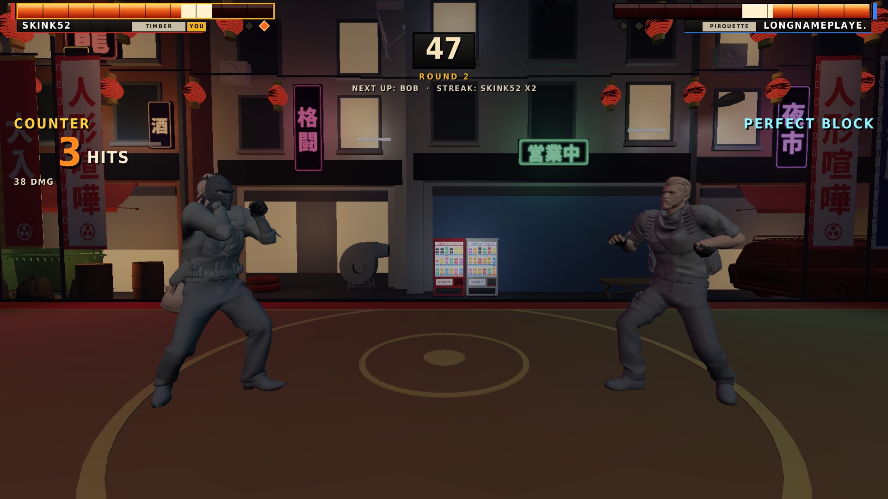

# Puppet Brawl for CS2 (mg_cs2_fighter)

A 2.5D street fighter that runs entirely inside one Counter-Strike 2 map as a cs_script, with no server plugins.
Fighters are CS2 agent models driven by an invisible animation rig, fighting on a neon back-street stage that
everyone else in the map can watch. Duel (winner stays on) and 2v2 tag team, CPU opponents, combos, specials,
throws, perfect blocks and a custom Panorama HUD.

> **About the code:** the code in this repository (the game, the generators and the build tools) was written by an
> AI coding agent (Claude, by Anthropic). skink52 directed the project, tested it in CS2, did the Hammer work and
> publishes the map, but is not the author of the code. Please keep that in mind when reading or reusing it.

Everything here is original work: the name, fighters, moves, stage art and rules. The genre conventions it uses
(health bars, rounds, specials, combos) belong to nobody.



More in `preview/`: the arena from several cameras, the HUD in each state (and with CS2's own HUD places
marked), every fighter's moves at the moment of contact.

## How it fits together

- **Animation is the source of truth.** Every move and state is a 3D clip built on the CS2 agent skeleton
  (`tools/anim/`), keyed on each fighter's stance with IK for hands and feet. The same clips are baked to
  2D joint tracks that the game core samples for its hit and hurt boxes, so what you see is what hits.
- **The core** (`src/core_*.js`) is plain JavaScript with no engine calls: fighters, moves, rounds, the CPU,
  the impact system (hitstop tiers, camera kick, sparks, layered sounds, counter hits, block pushback) and
  the camera. It runs in Node for the tests and in the browser preview.
- **The CS2 side** (`src/cs2_*.js`) turns that into entities: the rig props and bone-merged agents, the fight
  camera, effects, world text, sounds and the HUD.
- **The arena** is built onto Hammer saves of the map by `tools/arena.py`, which keeps every game entity
  and replaces the decoration.

## Layout

| Folder | What it is |
|---|---|
| `src/` | The game: `core_*.js` (engine-free) and `cs2_*.js` (CS2 adapter and settings). |
| `tools/anim/` | The animation pipeline: stances, keyed clips for every move and state, IK, baking to 2D tracks, SMD + ModelDoc output, review renders on the real agent meshes. |
| `tools/` | `make.mjs` (whole build), `build.mjs` (the script), `make_props.py` (props and materials), `make_hud.py` (Panorama layout and styles), `arena.py` (the map's look), `arena_preview.mjs` and `hud_preview.py` (offline renders and checks), `dmx9.py` / `vmaplib.py` (Hammer's binary .vmap), `s2/` and `vpk.py` (reading the game's own files). `history/` holds one-off passes applied to earlier saves. |
| `test/` | Mechanics tests, a mock of CS2's script API that runs the real built script, balance runs. |
| `assets/` | The addon README and the sound events. |
| `ref/` | The Hammer save the arena is built onto, and the old system's reach reference. |
| `preview/` | Rendered previews of the arena, the HUD and the animation. |

## Building

```
node tools/make.mjs                        # script, every animation clip and its baked tracks -> dist/
python3 tools/make_props.py dist/addon     # props, materials, effect models
python3 tools/make_hud.py dist/addon       # Panorama layout + styles
python3 tools/arena.py ref/mg_cs2_fighter_14oct.vmap dist/addon/maps/mg_cs2_fighter.vmap dist/scene.json
node test/mechanics.mjs && node test/sim_cs2.mjs
python3 tools/hud_preview.py dist/addon <background.png> preview/hud     # layout rules + CS2's HUD zones
node tools/arena_preview.mjs dist/scene.json preview/arena.png            # needs the game's prop models extracted
```

The addon folder on the PC is `content/csgo_addons/mg_cs2_fighter`. Only changed files are copied there.
